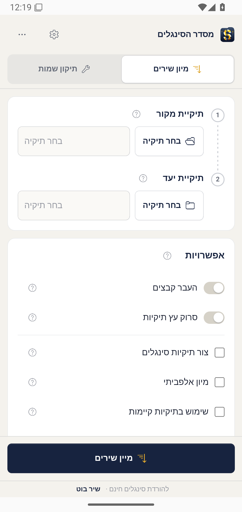
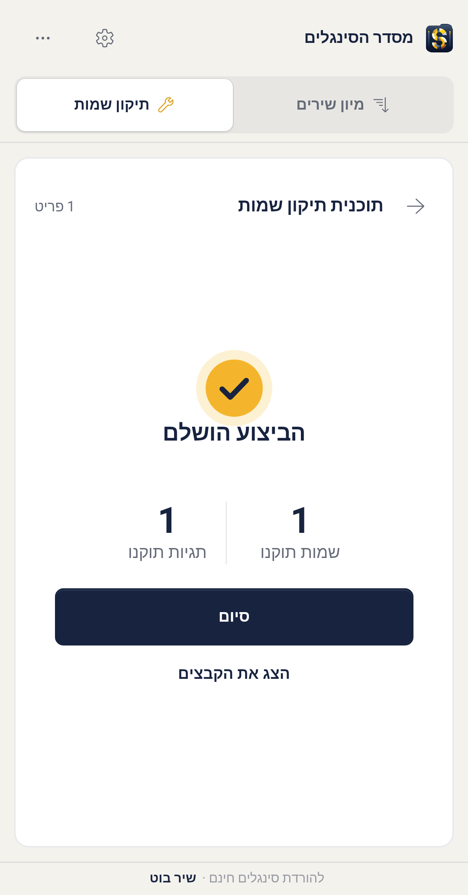
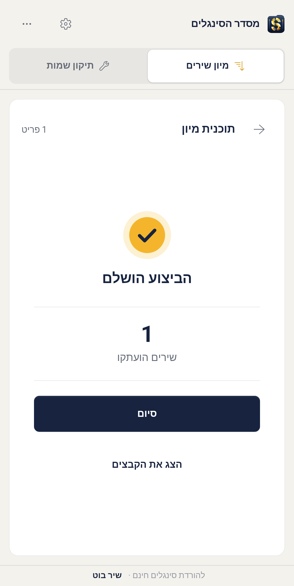

# Singles Sorter 15.0 beta acceptance, 2026-10-26

The deliverable is **15.0.0-beta.1**, Android package
`com.nhlocal.singlesorter`, version code `1500001`, minimum API29 and target API35.
It is a beta candidate, not a published stable release.

## Exact artifact

- APK: `Singles-Sorter-15.0.0-beta.1.apk`, 23,227,418 bytes
- SHA256: `64e260995a4881e055523e082456df04e752527b16fc0368adc7ff18575516c2`
- Source: `ca8b81fefc2e8706bb6017e8c82b35df45e7ffb5`, clean tracked tree
- Certificate: `6b40783e5ffe29c4659fa48d1e20a12df583a0f606a74aba710b10275537ef41`
- Local output: `C:\Users\me\Documents\Codex\Singles-Sorter-15.0.0-beta.1-ready`
- Release signing verified; manifest is not debuggable; 16 KiB ZIP alignment passed
- Both x86_64 and ARM64 JNI libraries are included

The original native/model/license payload was extracted from the locally retained
`befef62` build artifact and checked against its entry-by-entry SHA256 receipt.
Native Rust implementation sources did not change between that revision and this
build; workspace package versions changed. Java, DEX, application resources and
Android-mode UI were rebuilt locally. This was not a fresh Rust cross-compilation.
All non-manifest/non-signature entries of the final QA and release APKs are identical.

## Actual runtime and data verification

Tests used owned local SDK emulators, the real shared WebView, native bridge,
system folder picker, persisted read/write grants and local external-storage
provider. No storage mock or substituted sorting backend was used. Test music
was confined to authored fixture directories under `Music`.

| Check | Observed result |
| --- | --- |
| Android 11/API30 x86_64 final signed APK | Installed and launched; Copy, Move and Fix completed through the app UI |
| Copy | Source retained; artist directory created; destination bytes match the source |
| Move | Destination bytes match; source removed only after execution completed |
| Fix | Underscores cleaned from filename; artist, album artist, album, title and genre converted to Hebrew |
| Fix preservation | Track 7 and MPEG audio bytes retained; original backup is byte-identical |
| Hebrew filename | `בדיקת_שם_קובץ.mp3` became `בדיקת שם קובץ.mp3`, with identical file bytes in the earlier QA run |
| Same-key APK replacement | `adb install -r` succeeded without uninstall; all 12 original journal files retained exactly |
| Android 15/API35 x86_64 | Final signed APK installed and launched; real SAF Copy completed with source retention and byte-identical destination; native bars no longer overlap the UI |
| Wrong signing key | Release rejected; no distributable output created |

## Layout and automated checks

- 247 frontend tests, TypeScript check and Android/desktop frontend builds passed
- 23 browser renderer checks passed using system Edge; IPC was mocked only in this separate renderer suite
- All 34 Java ownership/policy test programs passed on Android's runtime
- Strict Java compilation with warnings as errors passed
- Six Android Python release/ELF tests passed; workflow YAML parsed
- Real WebView spacing checks passed on Android 11 and 15 at 393 CSS pixels:
  10 px control/text spacing, 6 px icon/text spacing, 8 px picker/field spacing,
  48 px phone option rows without extra sibling margin and no horizontal overflow
- Checked the Sort setup and advanced settings, including duet radios and personal-list actions

The reusable measured check is
[`check_webview_spacing.mjs`](../apps/singles-android/tests/check_webview_spacing.mjs).
Forward the installed QA WebView DevTools socket with adb and run it against the
app's setup screen. Rooted SDK emulators also permit instrumentation of the
same-key release package; that does not make the release manifest debuggable.

## Release boundary

Physical ARM64, removable SD cards, cloud providers, large libraries and 16 KiB
page-size device runtime have not been qualified by this run. Android 15 Copy
verification does not substitute for the full Android 11 Move/Fix evidence.
The provider contract remains local-system-provider and quiescent writers.

The old 14.0 signing key was not recovered. The owner authorized a new permanent
key, stored in two verified local copies and repository Actions secrets. Therefore
14.0 requires the documented one-time reinstall/export/import transition;
subsequent 15.x updates use the permanent certificate and increasing version codes.
See the [signing and recovery guide](../apps/singles-android/docs/signing-and-v15-updates.md).

Windows product identity/version was updated in source. A version 15 Windows
installer and physical Windows upgrade were not produced or qualified here.
No public release, tag, remote push or Actions run was created by this local work.
